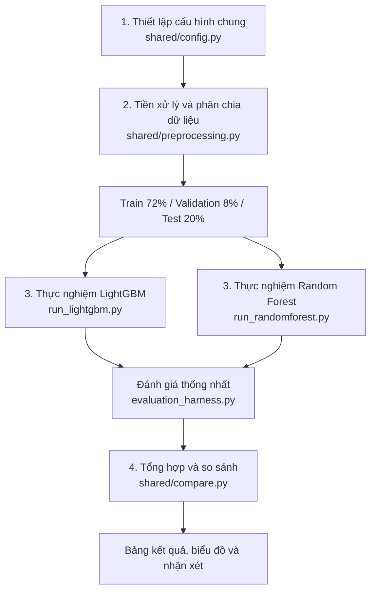

# Dự đoán cước taxi – Taxi Fare Prediction

**Môn học:** Kho dữ liệu và OLAP (IS217.R11)  
**Giảng viên hướng dẫn:** ThS. Đỗ Thị Minh Phụng  
**Đề tài:** Xây dựng kho dữ liệu và OLAP phân tích hoạt động chuyến đi của Taxi Vàng trong 8 tháng đầu năm 2026 tại Thành phố New York (NYC Yellow Taxi Trip Records).

**Nhóm thực hiện:**
- Trần Thị Phương Linh – 24520971
- Bùi Phan Giáng Trân – 24521808

Repository lưu trữ mã nguồn thực nghiệm Data Mining của đồ án, sử dụng kiến trúc Data Contract để thống nhất dữ liệu, cấu hình và phương pháp đánh giá giữa các mô hình.

## Mục lục

1. [Giới thiệu đề tài và mục tiêu](#1-giới-thiệu-đề-tài-và-mục-tiêu)
2. [Quy trình thực nghiệm](#2-quy-trình-thực-nghiệm)
3. [Cấu trúc thư mục](#3-cấu-trúc-thư-mục)
4. [Chức năng các thành phần](#4-chức-năng-các-thành-phần)
5. [Cài đặt môi trường](#5-cài-đặt-môi-trường)
6. [Hướng dẫn thực thi](#6-hướng-dẫn-thực-thi)
7. [Phương pháp đánh giá](#7-phương-pháp-đánh-giá)
8. [Tổ chức thực nghiệm và tổng hợp báo cáo](#8-tổ-chức-thực-nghiệm-và-tổng-hợp-báo-cáo)
9. [Xử lý sự cố](#9-xử-lý-sự-cố)

## 1. Giới thiệu đề tài và mục tiêu

Phần khai phá dữ liệu giải quyết bài toán hồi quy (Regression): dự đoán tiền cước taxi (`total_amount`) từ các thuộc tính chuyến đi được trích xuất từ kho dữ liệu NYC Yellow Taxi.

Theo định nghĩa biến mục tiêu trong `shared/config.py`, `total_amount` biểu diễn tiền cước và phụ phí, không bao gồm tiền tip.

Hai thuật toán được sử dụng là **LightGBM** và **Random Forest**. Ngoài cấu hình LightGBM thông thường, thực nghiệm khảo sát thêm khả năng xử lý trực tiếp các thuộc tính phân loại (Native Category) của LightGBM.

Mục tiêu thực nghiệm:

- Đánh giá khả năng dự đoán cước taxi của các mô hình hồi quy trên cùng tập dữ liệu kiểm thử.
- So sánh sai số dự đoán, thời gian huấn luyện và thời gian suy luận theo một quy trình đánh giá thống nhất.
- Tăng khả năng tái lập bằng cách cố định `RANDOM_SEED = 42`, sử dụng chung cấu hình và dữ liệu phân chia. Kết quả và thời gian chạy vẫn có thể thay đổi theo phiên bản thư viện và môi trường thực thi.
- Sử dụng định dạng Parquet để lưu trữ dữ liệu đã xử lý theo dạng cột, hỗ trợ đọc ghi hiệu quả.

## 2. Quy trình thực nghiệm

Quy trình gồm bốn giai đoạn, từ thống nhất cấu hình đến tổng hợp kết quả.



| Giai đoạn | Nội dung | Đầu ra |
|---|---|---|
| 1. Cấu hình | Xác định 8 đặc trưng, biến mục tiêu, seed, điều kiện làm sạch và siêu tham số | Cấu hình thực nghiệm thống nhất |
| 2. Tiền xử lý | Đọc CSV, chuyển kiểu, loại bỏ dữ liệu không hợp lệ và chia tập dữ liệu | `train.parquet`, `valid.parquet`, `test.parquet` |
| 3. Huấn luyện và đánh giá | Huấn luyện LightGBM và Random Forest; đánh giá bằng module dùng chung | Các file kết quả và Feature Importance |
| 4. So sánh | Tổng hợp chỉ số, vẽ biểu đồ và tạo nhận xét | `results_comparison.csv`, `comparison_chart.png`, `comparison_summary.txt` |

Các mô hình có thể được thực nghiệm độc lập sau khi đã chuẩn bị dữ liệu. Trên máy có tài nguyên hạn chế, nên chạy lần lượt để tránh cạnh tranh CPU và RAM.

## 3. Cấu trúc thư mục

```text
IS217_OLAP/
├── README.md
├── requirements.txt
├── .gitignore
├── setup_project.py
├── feature_importance.png
├── lgb_total_amount.pkl
└── project/
    ├── requirements.txt
    ├── data/
    │   ├── raw/
    │   │   └── dataset.csv
    │   ├── train.parquet
    │   ├── valid.parquet
    │   └── test.parquet
    ├── shared/
    │   ├── __init__.py
    │   ├── config.py
    │   ├── preprocessing.py
    │   ├── data_io.py
    │   ├── evaluation_harness.py
    │   ├── compare.py
    │   ├── results_template.csv
    │   └── run_all.py
    ├── nhanh_A_lightgbm/
    │   ├── __init__.py
    │   └── run_lightgbm.py
    ├── nhanh_B_randomforest/
    │   ├── __init__.py
    │   └── run_randomforest.py
    └── reports/
        ├── results_lightgbm.csv
        ├── results_lightgbm_native_category.csv
        ├── results_randomforest.csv
        ├── feature_importance_lightgbm.csv
        ├── feature_importance_lightgbm_native_category.csv
        ├── feature_importance_randomforest.csv
        ├── results_comparison.csv
        ├── comparison_chart.png
        └── comparison_summary.txt
```

Thư mục `project/` chứa pipeline thực nghiệm chính. Tên các package được giữ nguyên theo mã nguồn để bảo đảm tương thích với các lệnh thực thi.

## 4. Chức năng các thành phần

### 4.1. Thư mục `shared/` – Module dùng chung

| File | Chức năng |
|---|---|
| `__init__.py` | Khai báo Python package. |
| `config.py` | Định nghĩa đặc trưng, biến mục tiêu, đường dẫn, seed, điều kiện làm sạch và siêu tham số. |
| `preprocessing.py` | Đọc CSV, làm sạch, phân chia dữ liệu và ghi ba tập Parquet. |
| `data_io.py` | Đọc các tập Parquet, tách đặc trưng và nhãn; hỗ trợ biểu diễn categorical khi được yêu cầu. |
| `evaluation_harness.py` | Tính MAE trên Validation; tính MAE, MSE, RMSE, R² trên Test; ghi nhận thời gian và xuất kết quả, Feature Importance. |
| `compare.py` | Tổng hợp các file `results_*.csv` (trừ bảng tổng hợp), vẽ biểu đồ bằng Matplotlib và xuất nhận xét so sánh. |
| `results_template.csv` | Mẫu cấu trúc bảng kết quả. |
| `run_all.py` | Điều phối tiền xử lý, Random Forest, LightGBM thông thường và so sánh kết quả. |

#### Đặc trưng đầu vào và biến mục tiêu

| Thuộc tính | Vai trò | Ý nghĩa |
|---|---|---|
| `trip_distance` | Feature | Khoảng cách chuyến đi (mile) |
| `PULocationID` | Feature | Mã khu vực đón khách |
| `DOLocationID` | Feature | Mã khu vực trả khách |
| `Hour` | Feature | Giờ thực hiện chuyến đi |
| `Weekday` | Feature | Thứ trong tuần |
| `PeakHour` | Feature | Chỉ báo giờ cao điểm |
| `RatecodeID` | Feature | Mã loại giá cước |
| `passenger_count` | Feature | Số hành khách |
| `total_amount` | Target | Tiền cước và phụ phí theo định nghĩa của project (USD) |

Ba thuộc tính `PULocationID`, `DOLocationID` và `RatecodeID` được khai báo trong `CATEGORICAL_COLS`.

#### Quy tắc tiền xử lý

Dữ liệu CSV được đọc với `header=None` và gán tên cột theo `CSV_COLUMNS`. Các thuộc tính được chuyển sang kiểu số; các dòng chứa giá trị thiếu hoặc không hợp lệ bị loại bỏ.

| Thuộc tính | Điều kiện giữ lại |
|---|---|
| `total_amount` | Từ 0,01 đến 500 USD |
| `trip_distance` | Từ 0,01 đến 100 mile |
| `passenger_count` | Từ 1 đến 6 |
| `Hour` | Từ 0 đến 23 |
| `Weekday` | Từ 0 đến 6 |
| `PeakHour` | 0 hoặc 1 |

Các cột mã và thời gian được lưu dưới dạng `int32`; `trip_distance` và `total_amount` dưới dạng `float32`. Pipeline hiện tại đọc toàn bộ file đầu vào, không sử dụng tham số `SAMPLE_SIZE`.

### 4.2. Thư mục `data/` – Dữ liệu thực nghiệm

| File | Nội dung |
|---|---|
| `raw/dataset.csv` | Dữ liệu đầu vào trích xuất phục vụ Data Mining; không bị ghi đè bởi pipeline. |
| `train.parquet` | Tập huấn luyện, xấp xỉ 72% dữ liệu sau làm sạch. |
| `valid.parquet` | Tập Validation, xấp xỉ 8% dữ liệu sau làm sạch. |
| `test.parquet` | Tập kiểm thử độc lập với quá trình fit, xấp xỉ 20% dữ liệu sau làm sạch. |

Code tách 20% dữ liệu làm Test trước (`TEST_SIZE = 0.2`), sau đó tách 10% của 80% còn lại làm Validation (`VALID_SIZE = 0.1`). Tỷ lệ cuối cùng xấp xỉ 72/8/20, có thể chênh lệch rất nhỏ do làm tròn số dòng.

Tất cả cấu hình mô hình sử dụng chung ba tập này. Parquet hỗ trợ lưu trữ theo cột và nén dữ liệu; mức giảm dung lượng và tốc độ đọc thực tế phụ thuộc vào dữ liệu và môi trường.

### 4.3. Mô hình LightGBM

**Mã nguồn:** [`project/nhanh_A_lightgbm/run_lightgbm.py`](project/nhanh_A_lightgbm/run_lightgbm.py)

LightGBM Regressor sử dụng phương pháp Gradient Boosting trên cây quyết định. Hai cấu hình được khảo sát:

- **LightGBM:** sử dụng các thuộc tính đầu vào dưới dạng số.
- **LightGBM (Native Category):** chuyển ba thuộc tính phân loại sang kiểu `category` thông qua `data_io.py`, cho phép LightGBM xử lý trực tiếp mà không cần One-Hot Encoding. Code hiện tại thống nhất danh mục bằng các giá trị xuất hiện trong ba tập dữ liệu; đây là đặc điểm của quy trình hiện hành cần được lưu ý khi diễn giải tính độc lập của tập kiểm thử.

| Siêu tham số | Giá trị |
|---|---:|
| `n_estimators` (tối đa) | 2000 |
| `learning_rate` | 0.05 |
| `num_leaves` | 63 |
| `min_child_samples` | 50 |
| `importance_type` | `gain` |
| `n_jobs` | -1 |
| `random_state` | 42 |
| Early stopping rounds | 50 |

Mô hình theo dõi MAE (`l1`) trên tập Validation để thực hiện Early Stopping. Số vòng boosting thực tế được ghi nhận qua `best_iteration_`.

**Đầu ra:** file `results_lightgbm.csv`, `feature_importance_lightgbm.csv` và hai file tương ứng có hậu tố `_native_category` khi bật cấu hình Native Category.

### 4.4. Mô hình Random Forest

**Mã nguồn:** [`project/nhanh_B_randomforest/run_randomforest.py`](project/nhanh_B_randomforest/run_randomforest.py)

Random Forest Regressor kết hợp nhiều cây quyết định theo phương pháp Bagging và lấy trung bình kết quả dự đoán của các cây. Mô hình sử dụng các thuộc tính dạng số từ dữ liệu đã tiền xử lý.

| Siêu tham số | Giá trị |
|---|---:|
| `n_estimators` | 100 |
| `max_depth` | 20 |
| `min_samples_leaf` | 5 |
| `n_jobs` | -1 |
| `random_state` | 42 |

Mô hình được fit trên Train; Validation và Test được sử dụng trong module đánh giá. Cấu hình hiện tại không sử dụng Early Stopping cho Random Forest.

**Đầu ra:** `results_randomforest.csv` và `feature_importance_randomforest.csv`.

### 4.5. Thư mục `reports/` – Kết quả thực nghiệm

| File | Nội dung |
|---|---|
| `results_lightgbm.csv` | Kết quả LightGBM thông thường |
| `results_lightgbm_native_category.csv` | Kết quả LightGBM Native Category |
| `results_randomforest.csv` | Kết quả Random Forest |
| `feature_importance_lightgbm.csv` | Tầm quan trọng tương đối của đặc trưng trong LightGBM |
| `feature_importance_lightgbm_native_category.csv` | Tầm quan trọng tương đối trong LightGBM Native Category |
| `feature_importance_randomforest.csv` | Tầm quan trọng tương đối trong Random Forest |
| `results_comparison.csv` | Bảng tổng hợp kết quả các cấu hình |
| `comparison_chart.png` | Biểu đồ so sánh MAE, RMSE và thời gian huấn luyện |
| `comparison_summary.txt` | Nhận xét tự động khi đối chiếu LightGBM với Random Forest |

Feature Importance được chuẩn hóa thành tỷ trọng theo tổng giá trị importance của từng mô hình. Các phương pháp tính importance khác nhau giữa LightGBM và Random Forest; không nên diễn giải các tỷ trọng như thước đo quan hệ nhân quả.

### 4.6. Các file hỗ trợ ở thư mục gốc

- `requirements.txt`: danh sách thư viện ở cấp repository. Pipeline chính sử dụng `project/requirements.txt`.
- `.gitignore`: cấu hình bỏ qua các file không cần quản lý bằng Git.
- `setup_project.py`: script hỗ trợ khởi tạo cấu trúc dự án; không cần chạy lại khi repository đã có đầy đủ mã nguồn.
- `feature_importance.png`, `lgb_total_amount.pkl`: sản phẩm khảo sát/thực nghiệm ban đầu; không phải đầu vào bắt buộc của pipeline hiện tại.

## 5. Cài đặt môi trường

### 5.1. Tải mã nguồn

```bash
git clone https://github.com/PhuongLinh2finh3/IS217_OLAP.git
cd IS217_OLAP
```

Nếu đã clone repository, chỉ cần mở Terminal tại thư mục gốc `IS217_OLAP`.

### 5.2. Tạo và kích hoạt môi trường ảo

Sử dụng Python 3 tương thích với các thư viện trong `project/requirements.txt`.

**Windows – PowerShell:**

```powershell
python --version
python -m venv .venv
.\.venv\Scripts\Activate.ps1
```

Nếu PowerShell chặn kích hoạt môi trường, xem mục 9.3.

**Windows – Command Prompt:**

```cmd
python -m venv .venv
.venv\Scripts\activate.bat
```

**Linux / macOS:**

```bash
python3 -m venv .venv
source .venv/bin/activate
```

### 5.3. Cài đặt thư viện

Tại thư mục gốc repository, sau khi kích hoạt môi trường:

```bash
python -m pip install --upgrade pip
python -m pip install -r project/requirements.txt
```

| Thư viện | Mục đích |
|---|---|
| pandas, numpy | Xử lý dữ liệu và tính toán |
| scikit-learn | Chia dữ liệu, Random Forest và các độ đo |
| lightgbm | Huấn luyện LightGBM |
| pyarrow | Đọc và ghi Parquet |
| matplotlib | Trực quan hóa kết quả |

Kiểm tra môi trường:

```bash
python -c "import pandas, numpy, sklearn, lightgbm, pyarrow, matplotlib; print('OK - All libraries installed')"
```

## 6. Hướng dẫn thực thi

Tất cả các lệnh module dưới đây được thực hiện **bên trong thư mục `project/`** và sử dụng môi trường Python đã cài đặt.

```bash
cd project
```

### 6.1. Tiền xử lý dữ liệu

Kiểm tra `data/raw/dataset.csv` tồn tại, sau đó chạy:

```bash
python -m shared.preprocessing
```

Kết quả: chương trình in số dòng ban đầu, số dòng bị loại bỏ, kích thước các tập và ghi đè `train.parquet`, `valid.parquet`, `test.parquet` trong `data/`.

### 6.2. Huấn luyện LightGBM

Chạy cả hai cấu hình LightGBM:

```bash
python -m nhanh_A_lightgbm.run_lightgbm --native
```

Nếu chỉ cần LightGBM thông thường, sử dụng:

```bash
python -m nhanh_A_lightgbm.run_lightgbm
```

Tham số `--native` chạy cấu hình thông thường trước, sau đó chạy thêm cấu hình Native Category. Kết quả và Feature Importance được ghi vào `reports/`.

### 6.3. Huấn luyện Random Forest

```bash
python -m nhanh_B_randomforest.run_randomforest
```

Kết quả đánh giá và Feature Importance của Random Forest được lưu trong `reports/`.

### 6.4. Tổng hợp và so sánh kết quả

Sau khi hoàn thành các cấu hình cần đánh giá:

```bash
python -m shared.compare
```

Chương trình in bảng điểm và xuất ba file:

```text
reports/results_comparison.csv
reports/comparison_chart.png
reports/comparison_summary.txt
```

**Lưu ý khi thực nghiệm lại:** `compare.py` đọc tất cả các file kết quả phù hợp trong `reports/`. Cần sao lưu và dọn các đầu ra cũ không thuộc lần chạy hiện tại để tránh trộn kết quả. Không xóa `data/raw/dataset.csv` hoặc các file mã nguồn. Các đầu ra cùng tên được ghi đè khi chạy lại.

### 6.5. Chạy tự động pipeline cơ bản

```bash
python -m shared.run_all
```

Lệnh này thực hiện tiền xử lý, Random Forest, LightGBM thông thường và so sánh. Script hiện tại không tự chạy cấu hình Native Category; muốn tái tạo đầy đủ ba cấu hình cần thực hiện theo các mục 6.1–6.4.

## 7. Phương pháp đánh giá

Các mô hình sử dụng chung `evaluation_harness.py` để thống nhất công thức đánh giá.

| Chỉ số | Đơn vị | Ý nghĩa | Xu hướng tốt |
|---|---|---|---|
| MAE | USD | Sai số tuyệt đối trung bình trên Test | Thấp |
| MSE | USD² | Sai số bình phương trung bình trên Test | Thấp |
| RMSE | USD | Căn bậc hai của MSE, nhạy hơn với sai số lớn | Thấp |
| R² | Không đơn vị | Hệ số xác định trên Test; có thể âm | Gần 1 |
| MAE_valid | USD | Sai số tuyệt đối trung bình trên Validation | Thấp |
| Training time | Giây | Thời gian thực hiện `model.fit()` | Thấp |
| Inference time | Giây | Thời gian dự đoán toàn bộ tập Test | Thấp |

Ngoài các độ đo trên, file kết quả lưu số mẫu Train/Test và thông tin siêu tham số. Khi đánh giá hiệu năng tính toán, cần sử dụng cùng cấu hình phần cứng và điều kiện thực thi để so sánh có ý nghĩa.

## 8. Tổ chức thực nghiệm và tổng hợp báo cáo

Quy trình thực nghiệm được tổ chức theo các module chức năng, bảo đảm các mô hình sử dụng thống nhất dữ liệu và phương pháp đánh giá.

| Hạng mục | Nội dung thực hiện | Sản phẩm |
|---|---|---|
| Chuẩn bị dữ liệu | Trích xuất dữ liệu, làm sạch và chia Train/Validation/Test | CSV đầu vào và ba tập Parquet |
| Thực nghiệm LightGBM | Xây dựng, huấn luyện, đánh giá cấu hình thông thường và Native Category | Kết quả và Feature Importance của LightGBM |
| Thực nghiệm Random Forest | Xây dựng, huấn luyện và đánh giá mô hình | Kết quả và Feature Importance của Random Forest |
| Đánh giá thống nhất | Sử dụng cùng tập Test và module đánh giá | MAE, MSE, RMSE, R² và thời gian thực thi |
| Tổng hợp báo cáo | Đối chiếu độ chính xác, hiệu năng tính toán, phân tích đặc trưng và nhận xét | Bảng so sánh, biểu đồ, báo cáo và slide |

Kết quả được diễn giải theo từng tiêu chí thay vì mặc định một mô hình tốt nhất trên mọi phương diện. Các nhận xét trong báo cáo phải dựa trên cùng lần thực nghiệm hoặc bộ kết quả đã thống nhất.

## 9. Xử lý sự cố

### 9.1. `ModuleNotFoundError: No module named 'shared'`

**Nguyên nhân:** Terminal không đứng tại thư mục `project/` hoặc chạy file trực tiếp thay vì module.

**Khắc phục:** từ thư mục gốc repository:

```bash
cd project
python -m shared.preprocessing
```

### 9.2. `FileNotFoundError` đối với CSV hoặc Parquet

Kiểm tra file `project/data/raw/dataset.csv` tồn tại và đúng cấu trúc cột. Nếu thiếu các tập Parquet, chạy lại tiền xử lý từ thư mục `project/`:

```bash
python -m shared.preprocessing
```

### 9.3. PowerShell không cho phép chạy `Activate.ps1`

Từ thư mục gốc repository:

```powershell
Set-ExecutionPolicy -Scope Process -ExecutionPolicy Bypass
.\.venv\Scripts\Activate.ps1
```

Thiết lập trên chỉ áp dụng cho phiên PowerShell hiện tại.

### 9.4. Huấn luyện chậm hoặc thiếu RAM

Random Forest có thể tiêu thụ nhiều bộ nhớ khi huấn luyện trên tập dữ liệu lớn. Nên chạy lần lượt các mô hình, đóng ứng dụng không cần thiết và sử dụng máy có đủ tài nguyên. Nếu cần giảm `n_jobs` hoặc thay đổi siêu tham số trong `shared/config.py`, ghi rõ cấu hình mới và thực nghiệm lại tương ứng; không trộn kết quả với cấu hình chính thức. Không sử dụng `SAMPLE_SIZE` vì pipeline hiện tại không có tham số này.

### 9.5. Bảng so sánh chứa kết quả cũ

Sao lưu các kết quả trước đó ra ngoài `reports/`, dọn các file đầu ra không thuộc lần chạy hiện tại, chạy lại các mô hình và thực hiện:

```bash
python -m shared.compare
```

### 9.6. Chưa có kết quả LightGBM Native Category

Chạy từ thư mục `project/`:

```bash
python -m nhanh_A_lightgbm.run_lightgbm --native
python -m shared.compare
```

---

**IS217.R11 – Kho dữ liệu và OLAP | Trường Đại học Công nghệ Thông tin, ĐHQG-HCM | 2026**
