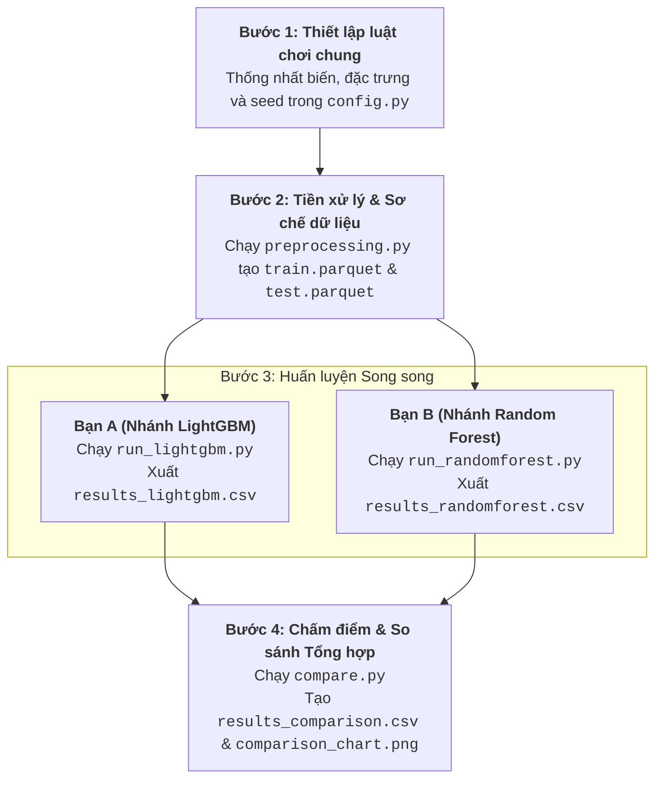

# 🚖 HƯỚNG DẪN DỰ ÁN DỰ ĐOÁN CƯỚC TAXI (TAXI FARE PREDICTION)
> **Môn học / Chuyên đề: Khoa học Dữ liệu & OLAP - Data Warehouse**  
> **Kiến trúc thiết kế:** Hợp đồng Dữ liệu Chuẩn hóa (Data Contract Pattern) cho làm việc nhóm.

---

## 📌 MỤC LỤC
1. [Giới thiệu Đề tài & Mục tiêu](#1-giới-thiệu-đề-tài--mục-tiêu)
2. [Quy trình Vận hành Chuẩn (4 Bước)](#2-quy-trình-vận-hành-chuẩn-4-bước)
3. [Cấu trúc Thư mục Toàn diện](#3-cấu-trúc-thư-mục-toàn-diện)
4. [Định nghĩa & Ý nghĩa Chi tiết Từng File](#4-định-nghĩa--ý-nghĩa-chi-tiết-từng-file)
   - [Thư mục `shared/` (Bộ điều phối dùng chung)](#-thư-mục-shared-bộ-điều-phối-dùng-chung)
   - [Thư mục `data/` (Kho dữ liệu)](#-thư-mục-data-kho-dữ-liệu)
   - [Thư mục `nhanh_A_lightgbm/` (Bạn A - Mô hình LightGBM)](#-thư-mục-nhanh_a_lightgbm-bạn-a---mô-hình-lightgbm)
   - [Thư mục `nhanh_B_randomforest/` (Bạn B - Mô hình Random Forest)](#-thư-mục-nhanh_b_randomforest-bạn-b---mô-hình-random-forest)
   - [Thư mục `reports/` (Kết quả & Báo cáo)](#-thư-mục-reports-kết-quả--báo-cáo)
   - [Các file công cụ hỗ trợ ở thư mục gốc](#-các-file-công-cụ-hỗ-trợ-ở-thư-mục-gốc)
5. [Hướng dẫn Cài đặt Môi trường (Khi mới Clone về)](#5-hướng-dẫn-cài-đặt-môi-trường-khi-mới-clone-về)
6. [3 Lệnh Thực thi Duy nhất cho Nhóm](#6-3-lệnh-thực-thi-duy-nhất-cho-nhóm)
7. [Quy chuẩn Đánh giá & Tiêu chí Chấm điểm (Metrics)](#7-quy-chuẩn-đánh-giá--tiêu-chí-chấm-điểm-metrics)
8. [Phân chia Công việc & Kịch bản Phối hợp](#8-phân-chia-công-việc--kịch-bản-phối-hợp)
9. [Xử lý Sự cố Thường gặp (Troubleshooting / FAQ)](#9-xử-lý-sự-cố-thường-gặp-troubleshooting--faq)

---

## 1. GIỚI THIỆU ĐỀ TÀI & MỤC TIÊU

Dự án này giải quyết bài toán hồi quy (Regression): **Dự đoán tổng số tiền cước taxi (`total_amount`)** dựa trên các thông tin chuyến đi từ bộ dữ liệu NYC Yellow Taxi Data Warehouse.

### Mục tiêu cốt lõi:
- **Tính công bằng & Khách quan:** Hai thành viên nghiên cứu 2 thuật toán Machine Learning khác nhau (**LightGBM** và **Random Forest**), nhưng được đảm bảo huấn luyện và kiểm thử trên **cùng một tập dữ liệu chuẩn**, cùng một công thức đánh giá sai số.
- **Tính tái lập (Reproducibility):** Cố định `RANDOM_SEED = 42` giúp bất kỳ ai chạy lại mã nguồn trên máy cá nhân đều cho ra đúng các chỉ số sai số giống hệt nhau.
- **Hiệu năng & Tối ưu:** Sử dụng định dạng lưu trữ cột nén cao cấp `Parquet` giúp tốc độ đọc/ghi dữ liệu tăng gấp nhiều lần so với file CSV truyền thống.

---

## 2. QUY TRÌNH VẬN HÀNH CHUẨN (4 BƯỚC)

Dự án áp dụng mô hình **Data Contract (Hợp đồng dữ liệu)** với quy trình 4 giai đoạn khép kín:



1. **Thiết lập luật chơi chung:** Cả nhóm cùng tuân thủ cấu hình trong `shared/config.py` (định nghĩa 8 features, target `total_amount`, tỉ lệ test 20%, seed 42).
2. **Sơ chế dữ liệu:** Chạy `shared/preprocessing.py` để làm sạch dữ liệu rác và chia tập dữ liệu. File dữ liệu sạch được lưu dưới dạng Parquet.
3. **Thực nghiệm độc lập:**
   - **Bạn A:** Huấn luyện mô hình LightGBM (`nhanh_A_lightgbm/run_lightgbm.py`).
   - **Bạn B:** Huấn luyện mô hình Random Forest (`nhanh_B_randomforest/run_randomforest.py`).
   Cả 2 cùng sử dụng hàm chấm điểm chuẩn hóa từ `shared/evaluation_harness.py`.
4. **Đối sánh kết quả:** Chạy `shared/compare.py` để tự động tổng hợp bảng so sánh các chỉ số và xuất biểu đồ trực quan phục vụ báo cáo.

---

## 3. CẤU TRÚC THƯ MỤC TOÀN DIỆN

```text
TaxiDW_Project/
│
├── README.md                           <- [TÀI LIỆU NÀY] Hướng dẫn toàn diện cho thành viên nhóm
├── requirements.txt                    <- Danh sách các thư viện Python cần cài đặt
├── .gitignore                          <- Cấu hình bỏ qua file rác, file tạm và dữ liệu nặng
│
├── project/                            <- Thư mục làm việc chính của mã nguồn đồ án
│   │
│   ├── shared/                         <- THƯ MỤC DÙNG CHUNG (TẬP LUẬT & TIỆN ÍCH)
│   │   ├── __init__.py                 <- Biến thư mục thành Python package
│   │   ├── config.py                   <- "Bộ não": Cấu hình features, paths, random_seed
│   │   ├── preprocessing.py            <- "Máy lọc": Xử lý dữ liệu thô -> train/test.parquet
│   │   ├── evaluation_harness.py       <- "Trọng tài": Hàm chuẩn hóa tính MAE, RMSE, R2, Time
│   │   ├── compare.py                  <- "Người tổng hợp": Gộp kết quả & vẽ biểu đồ so sánh
│   │   └── results_template.csv        <- File mẫu cấu trúc cột kết quả
│   │
│   ├── data/                           <- KHO CHỨA DỮ LIỆU
│   │   ├── raw/                        <- Chứa dữ liệu gốc (CSV xuất từ hệ thống DW/khảo sát)
│   │   │   └── ml_dataset_total_amount.csv
│   │   ├── train.parquet               <- Dữ liệu huấn luyện đã chuẩn hóa (80%)
│   │   └── test.parquet                <- Dữ liệu kiểm thử đã chuẩn hóa (20%)
│   │
│   ├── nhanh_A_lightgbm/               <- PHÂN HỆ BẠN A
│   │   └── run_lightgbm.py             <- Huấn luyện & đánh giá mô hình LightGBM
│   │
│   ├── nhanh_B_randomforest/           <- PHÂN HỆ BẠN B
│   │   └── run_randomforest.py         <- Huấn luyện & đánh giá mô hình Random Forest
│   │
│   └── reports/                        <- NƠI LƯU KẾT QUẢ THỰC NGHIỆM TỰ ĐỘNG
│       ├── results_lightgbm.csv        <- Kết quả chi tiết của mô hình LightGBM
│       ├── results_randomforest.csv    <- Kết quả chi tiết của mô hình Random Forest
│       ├── results_comparison.csv      <- Bảng gộp so sánh cả 2 mô hình
│       └── comparison_chart.png        <- Biểu đồ cột so sánh trực quan (MAE, RMSE)
│
└── [Khảo sát ban đầu]
    ├── khao_sat_project.py             <- Script kiểm tra toàn vẹn nội dung các file trong code
    ├── setup_project.py                <- Script khởi tạo cấu trúc thư mục tự động
    ├── KHAOSAT.py                      <- Script khảo sát thăm dò dữ liệu ban đầu
    ├── feature_importance.png          <- Biểu đồ phân tích độ quan trọng của đặc trưng
    └── lgb_total_amount.pkl            <- Model thử nghiệm ban đầu
```

---

## 4. ĐỊNH NGHĨA & Ý NGHĨA CHI TIẾT TỪNG FILE

### 📁 Thư mục `shared/` (Bộ điều phối dùng chung)

| File | Vai trò | Ý nghĩa & Tính năng kỹ thuật |
| :--- | :--- | :--- |
| `config.py` | **"Bộ não điều hành"** | • Chứa danh sách **8 đặc trưng (Features)**: `trip_distance`, `PULocationID`, `DOLocationID`, `Hour`, `Weekday`, `PeakHour`, `RatecodeID`, `passenger_count`.<br>• Biến mục tiêu (Target): `total_amount`.<br>• Cột định danh phân loại (`CATEGORICAL_COLS`): `PULocationID`, `DOLocationID`, `RatecodeID`.<br>• Hằng số cố định: `RANDOM_SEED = 42`, `TEST_SIZE = 0.2`, `SAMPLE_SIZE = 1,000,000`.<br>• Định nghĩa tất cả đường dẫn (paths) đọc/ghi trong dự án.<br>⚠️ **LƯU Ý:** Tuyệt đối không tự ý chỉnh sửa file này khi chưa bàn bạc thống nhất với toàn nhóm. |
| `preprocessing.py` | **"Máy lọc dữ liệu"** | • Đọc dữ liệu từ `data/raw/ml_dataset_total_amount.csv` theo kích thước `SAMPLE_SIZE`.<br>• Ép kiểu dữ liệu số an toàn (`pd.to_numeric`).<br>• Làm sạch dữ liệu bất thường (loại bỏ giá trị `NaN`, chuyến đi có `total_amount <= 0`, hoặc `trip_distance <= 0`).<br>• Phân chia Train/Test theo tỉ lệ 80/20 với seed cố định.<br>• Xuất dữ liệu ra 2 file `train.parquet` và `test.parquet`.<br>💡 **Tần suất chạy:** Chỉ cần chạy **1 lần duy nhất** lúc khởi tạo hoặc khi có nguồn dữ liệu mới. |
| `evaluation_harness.py`| **"Trọng tài chấm điểm"** | • Cung cấp hàm `evaluate_model()`: Thực hiện dự đoán trên tập Test và tính toán tập chỉ số khách quan: **MAE, MSE, RMSE, R2, thời gian train, thời gian suy luận (inference time)**.<br>• In bảng kết quả trực quan ra màn hình Console.<br>• Cung cấp hàm `save_result()`: Ghi kết quả vào file `.csv` theo mẫu chuẩn. Đảm bảo 2 bạn tính toán bằng cùng một công thức, không có sự sai lệch logic. |
| `compare.py` | **"Người tổng hợp"** | • Đọc 2 file `results_lightgbm.csv` và `results_randomforest.csv` từ thư mục `reports/`.<br>• Gộp kết quả thành bảng tổng hợp `results_comparison.csv`.<br>• Sử dụng `matplotlib` & `seaborn` vẽ biểu đồ cột đôi so sánh trực quan chỉ số `MAE` và `RMSE` giữa 2 mô hình.<br>• Xuất hình ảnh chất lượng cao `reports/comparison_chart.png` để đưa vào báo cáo và slide thuyết trình. |
| `results_template.csv` | **"Bản thiết kế mẫu"** | Quy định cấu trúc các cột chuẩn của bảng điểm kết quả: `model, MAE, MSE, RMSE, R2, training_time_seconds, inference_time_seconds`. |

---

### 📁 Thư mục `data/` (Kho dữ liệu)

- `data/raw/ml_dataset_total_amount.csv`: File dữ liệu trích xuất gốc từ Data Warehouse. Được giữ nguyên gốc để đảm bảo tính toàn vẹn (không ghi đè lên file này).
- `data/train.parquet`: Tập dữ liệu huấn luyện đã qua xử lý sạch sẽ (80% dữ liệu). **Nguyên liệu bắt buộc cả Bạn A và Bạn B phải dùng để train model**.
- `data/test.parquet`: Tập dữ liệu kiểm thử độc lập (20% dữ liệu). **Dùng chung để kiểm tra độ chính xác của cả 2 mô hình**.

> 💡 **Tại sao lại dùng định dạng `.parquet` thay vì `.csv`?**  
> Dữ liệu Parquet được tổ chức theo dạng cột (Columnar format) kèm nén snappy, giúp dung lượng giảm 70-80% so với CSV và tốc độ đọc vào bộ nhớ của Pandas/PyArrow nhanh gấp 5 - 10 lần.

---

### 📁 Thư mục `nhanh_A_lightgbm/` (Bạn A - Mô hình LightGBM)

*File: `nhanh_A_lightgbm/run_lightgbm.py`*
- **Người phụ trách:** Bạn A.
- **Thuật toán:** LightGBM Regressor (Gradient Boosting trên cây quyết định).
- **Cơ chế xử lý đặc trưng:** Tận dụng tính năng Native Categorical của LightGBM bằng cách chuyển đổi các cột `CATEGORICAL_COLS` sang kiểu dữ liệu `category` (`astype('category')`). Cách làm này giúp mô hình bắt được tính chất phân loại của vùng đón/trả khách mà không làm phình kích thước dữ liệu (không cần One-Hot Encoding).
- **Thiết lập siêu tham số chính:**
  - `n_estimators = 200`: Số lượng cây quyết định.
  - `learning_rate = 0.05`: Tốc độ học (shrinkage rate).
  - `num_leaves = 63`: Số lá tối đa trên mỗi cây.
  - `n_jobs = -1`: Tận dụng toàn bộ nhân CPU của máy.
- **Đầu ra:** Ghi nhận kết quả vào `reports/results_lightgbm.csv`.

---

### 📁 Thư mục `nhanh_B_randomforest/` (Bạn B - Mô hình Random Forest)

*File: `nhanh_B_randomforest/run_randomforest.py`*
- **Người phụ trách:** Bạn B.
- **Thuật toán:** Random Forest Regressor (Ensemble Bagging trên nhiều cây quyết định độc lập).
- **Cơ chế xử lý đặc trưng:** Vì thuật toán `RandomForestRegressor` của Scikit-learn không hỗ trợ trực tiếp kiểu `category`, script tự động chuyển đổi các cột phân loại sang kiểu số nguyên tối ưu bộ nhớ `int16` (`astype('int16')`).
- **Thiết lập siêu tham số chính:**
  - `n_estimators = 50`: Số cây trong rừng.
  - `max_depth = 15`: Giới hạn độ sâu tối đa để tránh overfitting và kiểm soát dung lượng RAM.
  - `n_jobs = -1`: Chạy song song đa luồng CPU.
- **Đầu ra:** Ghi nhận kết quả vào `reports/results_randomforest.csv`.

---

### 📁 Thư mục `reports/` (Kết quả & Báo cáo)

Thư mục này được tạo tự động để lưu trữ sản phẩm thực nghiệm:
- `results_lightgbm.csv`: Chỉ số đánh giá của riêng LightGBM.
- `results_randomforest.csv`: Chỉ số đánh giá của riêng Random Forest.
- `results_comparison.csv`: Bảng đối đầu trực tiếp giữa 2 mô hình.
- `comparison_chart.png`: Đồ thị so sánh độ lệch tuyệt đối (MAE) và độ lệch bình phương (RMSE).

---

### 📁 Các file công cụ hỗ trợ ở thư mục gốc

- `requirements.txt`: Danh sách phiên bản thư viện cần thiết để các thành viên cài đặt môi trường đồng nhất chỉ với một lệnh.
- `setup_project.py`: Script tự động khởi tạo bộ khung dự án và tạo sẵn các file mẫu nếu cần khôi phục lại cấu trúc.
- `khao_sat_project.py`: Script đọc và in toàn bộ mã nguồn của 6 file lõi ra màn hình Console để thành viên tự kiểm tra chéo (Code Audit) xem có bị gõ nhầm hoặc mất file hay không.
- `KHAOSAT.py`, `feature_importance.png`, `lgb_total_amount.pkl`: Các file khảo sát thăm dò độc lập được tạo trước đó trong quá trình phân tích đặc trưng ban đầu.

---

## 5. HƯỚNG DẪN CÀI ĐẶT MÔI TRƯỜNG (KHI MỚI CLONE VỀ)

Dành cho thành viên nhóm khi clone repository về máy tính cá nhân lần đầu tiên:

### Bước 5.1: Mở Terminal tại thư mục gốc của dự án (`TaxiDW_Project`)
Đảm bảo bạn đang đứng ở thư mục ngoài cùng:
```powershell
cd TaxiDW_Project
```

### Bước 5.2: Khởi tạo & Kích hoạt Môi trường ảo (Virtual Environment)
Khuyến nghị sử dụng Python 3.10 trở lên:

- **Trên Windows (PowerShell):**
  ```powershell
  python -m venv venv
  .\venv\Scripts\Activate.ps1
  ```
  *(Nếu gặp lỗi UnauthorizedAccess trong PowerShell, chạy lệnh: `Set-ExecutionPolicy -Scope Process -ExecutionPolicy Bypass` rồi kích hoạt lại).*

- **Trên Windows (Command Prompt - CMD):**
  ```cmd
  python -m venv venv
  venv\Scripts\activate.bat
  ```

- **Trên Linux / macOS:**
  ```bash
  python3 -m venv venv
  source venv/bin/activate
  ```

### Bước 5.3: Cài đặt các thư viện cần thiết
Chạy lệnh sau để cài đặt toàn bộ danh sách gói phụ thuộc chuẩn hóa:
```powershell
pip install -r requirements.txt
```

---

## 6. 3 LỆNH THỰC THI DUY NHẤT CHO NHÓM

> ⚠️ **QUY TẮC SỐNG CÒN VỀ ĐƯỜNG DẪN:**  
> Trước khi thực hiện bất kỳ lệnh Python nào dưới đây, bạn **BẮT BUỘC** phải chuyển vị trí dòng lệnh vào bên trong thư mục `project`:
> ```powershell
> cd project
> ```

Sau đó, toàn bộ quy trình chỉ gói gọn trong **3 lệnh**:

### 🔹 Lệnh 1: Tiền xử lý & Tạo tập Train/Test sạch
*(Chỉ cần 1 người chạy rồi gửi 2 file `.parquet` cho người còn lại, hoặc cả 2 cùng chạy nếu máy đã có file CSV thô)*:
```powershell
python -m shared.preprocessing
```
*Kết quả:* Hệ thống sinh ra 2 file `data/train.parquet` và `data/test.parquet`.

---

### 🔹 Lệnh 2: Huấn luyện mô hình (Mỗi người chạy 1 lệnh độc lập)

- **Bạn A (Phụ trách LightGBM):**
  ```powershell
  python -m nhanh_A_lightgbm.run_lightgbm
  ```
  *Kết quả:* Huấn luyện mô hình trong vài giây và xuất `reports/results_lightgbm.csv`.

- **Bạn B (Phụ trách Random Forest):**
  ```powershell
  python -m nhanh_B_randomforest.run_randomforest
  ```
  *Kết quả:* Huấn luyện mô hình (thời gian khoảng 1-3 phút tùy cấu hình CPU) và xuất `reports/results_randomforest.csv`.

---

### 🔹 Lệnh 3: Tổng hợp bảng so sánh & Xuất đồ thị
*(Chạy sau khi cả 2 bạn đã hoàn thành Lệnh 2 và thư mục `reports/` đã có đủ 2 file csv kết quả)*:
```powershell
python -m shared.compare
```
*Kết quả:* Bảng so sánh in ngay trên terminal, đồng thời xuất file `reports/results_comparison.csv` và ảnh biểu đồ `reports/comparison_chart.png`.

---

## 7. QUY CHUẨN ĐÁNH GIÁ & TIÊU CHÍ CHẤM ĐIỂM (METRICS)

Mô hình được đánh giá đồng thời qua 6 tiêu chí kỹ thuật:

| Chỉ số | Tên đầy đủ | Đơn vị đo | Ý nghĩa trong bài toán Taxi | Tiêu chuẩn đánh giá |
| :--- | :--- | :---: | :--- | :---: |
| **MAE** | Mean Absolute Error | USD ($) | Mức độ lệch trung bình giữa tiền cước dự đoán và tiền cước thực tế. Dễ giải thích cho người dùng thực tế. | **Càng thấp càng tốt** |
| **RMSE** | Root Mean Squared Error | USD ($) | Căn bậc hai sai số bình phương trung bình. Phạt rất nặng các trường hợp dự đoán sai lệch nghiêm trọng (outliers). | **Càng thấp càng tốt** |
| **MSE** | Mean Squared Error | $^2$ | Bình phương sai số trung bình (dùng để kiểm chứng toán học cho thuật toán tối ưu). | **Càng thấp càng tốt** |
| **R²** | Coefficient of Determination | Không đơn vị (≤ 1) | Tỷ lệ biến thiên của giá cước được giải thích bởi các đặc trưng trong mô hình (độ fit của mô hình). | **Càng gần 1 càng tốt** |
| **Train Time** | Training Time | Giây (s) | Thời gian mô hình hoàn thành quá trình fit dữ liệu trên tập Train (thể hiện chi phí tính toán). | **Càng nhanh càng tốt** |
| **Inference Time**| Inference Time | Giây (s) | Tốc độ dự đoán trên toàn bộ tập dữ liệu kiểm thử (thể hiện khả năng đáp ứng thời gian thực khi triển khai Production). | **Càng nhanh càng tốt** |

---

## 8. PHÂN CHIA CÔNG VIỆC & KỊCH BẢN PHỐI HỢP

| Thành viên | Trách nhiệm chính | Nhiệm vụ cụ thể |
| :---: | :--- | :--- |
| **Bạn A** | Phân hệ **LightGBM** & Quản trị Dữ liệu | 1. Chạy `shared.preprocessing` để tạo bộ dữ liệu Parquet.<br>2. Chạy `nhanh_A_lightgbm.run_lightgbm`.<br>3. Gửi file `reports/results_lightgbm.csv` cho Bạn B (hoặc push lên Git).<br>4. Viết phần lý thuyết mô hình LightGBM trong báo cáo (cơ chế Leaf-wise split, xử lý categorical). |
| **Bạn B** | Phân hệ **Random Forest** & Tổng hợp Báo cáo | 1. Nhận dữ liệu parquet hoặc chạy lại tiền xử lý.<br>2. Chạy `nhanh_B_randomforest.run_randomforest`.<br>3. Chạy `shared.compare` sau khi gom đủ 2 kết quả.<br>4. Thu thập ảnh `reports/comparison_chart.png` và bảng số liệu đưa vào báo cáo và slide.<br>5. Viết phần lý thuyết Random Forest (Bagging, Ensemble). |

---

## 9. XỬ LÝ SỰ CỐ THƯỜNG GẶP (TROUBLESHOOTING / FAQ)

### ❓ Lỗi 1: `ModuleNotFoundError: No module named 'shared'`
- **Nguyên nhân:** Bạn đang đứng sai thư mục khi gõ lệnh (ví dụ đứng ở thư mục ngoài cùng `TaxiDW_Project` hoặc trong thư mục con).
- **Cách khắc phục:** Luôn gõ `cd project` trước khi chạy các lệnh với cú pháp module `python -m ...`.

### ❓ Lỗi 2: `FileNotFoundError: [Errno 2] No such file or directory: 'data/train.parquet'`
- **Nguyên nhân:** Bạn chưa chạy Bước 1 (`preprocessing.py`) để sinh ra các file Parquet, hoặc file bị xóa.
- **Cách khắc phục:** Chạy lệnh:
  ```powershell
  python -m shared.preprocessing
  ```

### ❓ Lỗi 3: Lỗi quyền thực thi PowerShell (`running scripts is disabled on this system`)
- **Nguyên nhân:** Chính sách bảo mật của Windows PowerShell chặn file script `Activate.ps1`.
- **Cách khắc phục:** Mở PowerShell với quyền User bình thường và gõ:
  ```powershell
  Set-ExecutionPolicy -Scope Process -ExecutionPolicy Bypass
  .\venv\Scripts\Activate.ps1
  ```

### ❓ Lỗi 4: Máy tính yếu, chạy Random Forest bị đơ hoặc tràn RAM
- **Nguyên nhân:** Random Forest mặc định xây dựng nhiều cây với dữ liệu lớn có thể chiếm nhiều RAM.
- **Cách khắc phục:**
  1. Trong `shared/config.py`: Tạm thời giảm `SAMPLE_SIZE = 200000` (200 nghìn dòng).
  2. Hoặc trong `nhanh_B_randomforest/run_randomforest.py`: Điều chỉnh `n_estimators=30`, `max_depth=12`.

---
*Chúc nhóm thực hiện đồ án thành công và đạt kết quả tốt nhất! 🚀*
